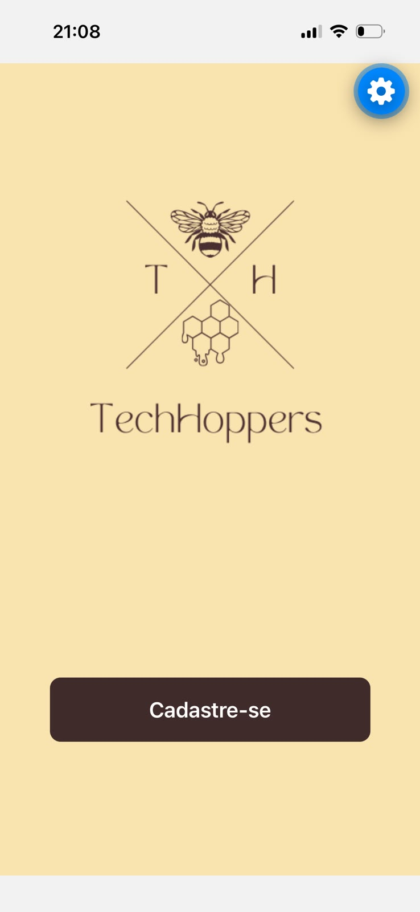
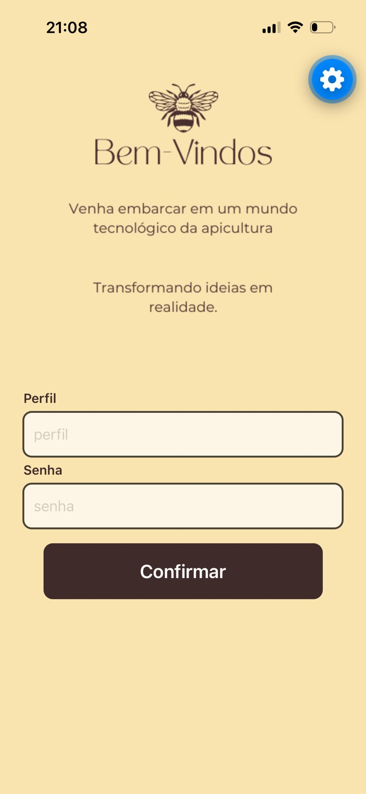
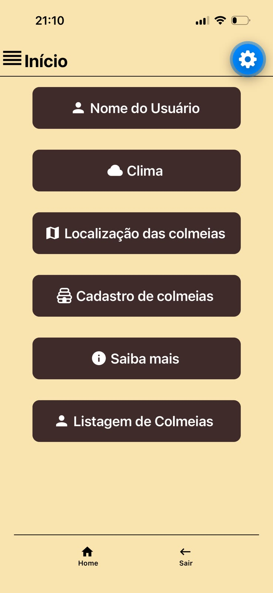
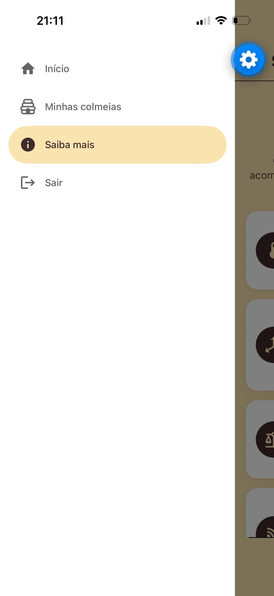
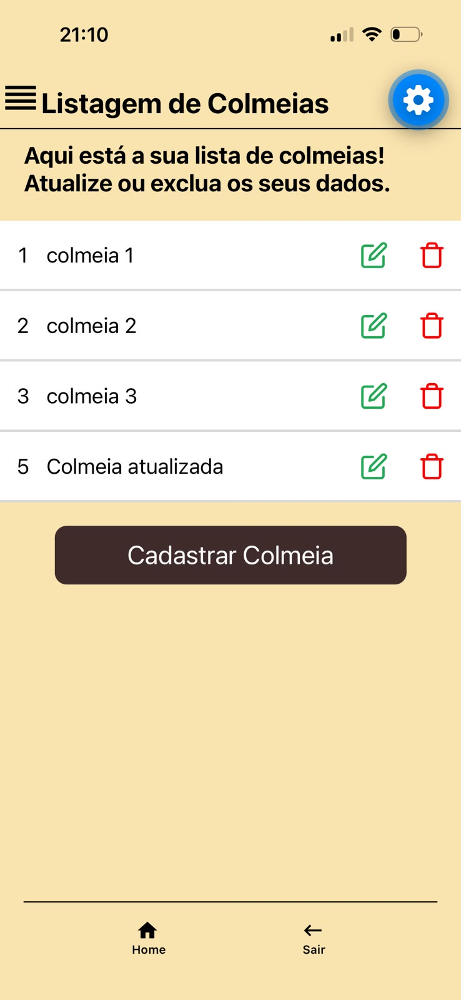
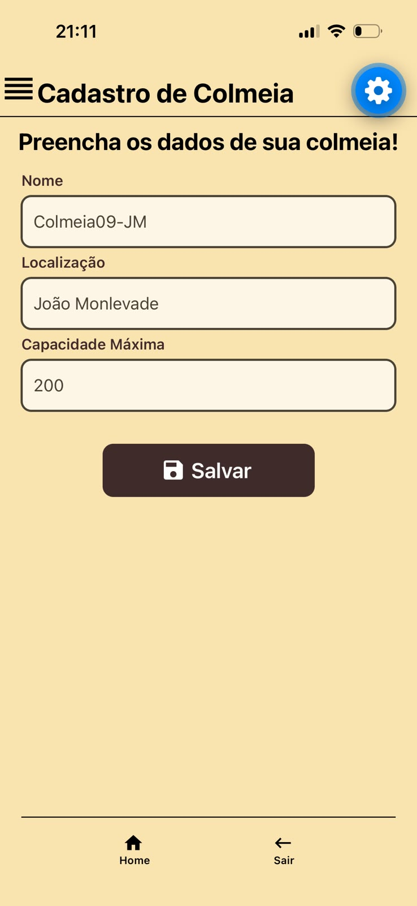
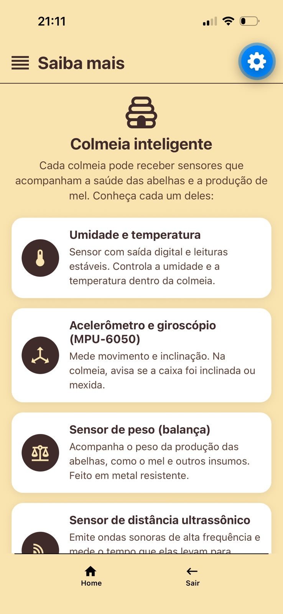

# 🐝 TechHoppers

Aplicativo mobile para **gerenciamento de colmeias inteligentes**, desenvolvido com **React Native (Expo)** e uma **API em Node.js**.

O projeto faz parte de uma proposta de colmeia com sensores (temperatura, umidade, peso, inclinação e distância) para ajudar apicultores a acompanhar a saúde das abelhas e a produção de mel. Projeto foi feito no ano de 2024 no IFMG campus Ponte Nova, desenvolvido pelos alunos: Anna Karolina, Danielle, Heitor, Matheus, Rafael, Marina e Maria Rita.

## 📱 Telas

<table>
  <tr>
    <td align="center"><br>Capa</td>
    <td align="center"><br>Login</td>
    <td align="center"><br>Início</td>
    <td align="center"><br>Menu</td>
  </tr>
  <tr>
    <td align="center"><br>Minhas colmeias</td>
    <td align="center"><br>Cadastro</td>
    <td align="center"><br>Saiba mais</td>
    <td></td>
  </tr>
</table>

## ⚙️ Funcionalidades

- 🔐 **Login** com rotas privadas: as telas internas só abrem depois de entrar
- 🐝 **Cadastro, edição, listagem e exclusão** de colmeias
- 📡 **Saiba mais:** informações sobre os sensores da colmeia inteligente
- ⚠️ **Tratamento de erros:** avisos de carregamento, lista vazia e API desligada
- 📂 **Menu lateral** com navegação entre as telas

## 🛠️ Tecnologias

**Mobile (`/mobile`)**
- React Native com Expo
- React Navigation (menu lateral e pilha de telas)
- Context API (controle de login)
- Axios (comunicação com a API)

**API (`/server`)**
- Node.js com Express
- TypeScript
- Knex.js
- SQLite

## 🧩 Como funciona

```
📱 App (React Native)  ──HTTP/JSON──▶  💻 API (Express)  ──▶  🗄️ Banco (SQLite)
```

| Método | Rota | Descrição |
|--------|------|-----------|
| GET | `/colmeias` | Lista todas as colmeias |
| GET | `/colmeia/:id` | Busca uma colmeia |
| POST | `/colmeia` | Cadastra uma colmeia |
| PUT | `/colmeia/:id` | Atualiza uma colmeia |
| DELETE | `/colmeia/:id` | Exclui uma colmeia |

## ▶️ Como executar

**Pré-requisitos:** Node.js (versão LTS) e o app **Expo Go** no celular. O celular e o computador precisam estar **no mesmo Wi-Fi**.

### 1. API

```
cd server
npm install
npm run dev
```

A API vai rodar em `http://localhost:3333`.

### 2. App

1. Descubra o IP do seu computador (no Windows: `ipconfig` → **Endereço IPv4**).
2. Coloque esse IP no arquivo `mobile/src/services/api.js`.
3. Rode:
   ```
   cd mobile
   npm install
   npx expo start
   ```
4. Escaneie o QR Code com o **Expo Go** (Android) ou com a **Câmera** (iPhone).

**Login de teste:** usuário `TechHoppers` · senha `teste123`

## 📜 História do projeto

O app foi criado em **2024** no Expo Snack. Em **2026** ele foi trazido para o GitHub e atualizado:

- Expo e bibliotecas atualizados para as versões atuais
- Endereço da API centralizado em um único arquivo
- Login com rotas públicas e privadas (antes era possível pular o login pelo menu)
- Correções no cadastro e na listagem (edição, exclusão e atualização da lista)
- Tratamento de erros na API, com códigos de resposta HTTP
- Nova tela "Saiba mais"

## 👤 Autor

Desenvolvido por **[Heitor Barros Alves]**.